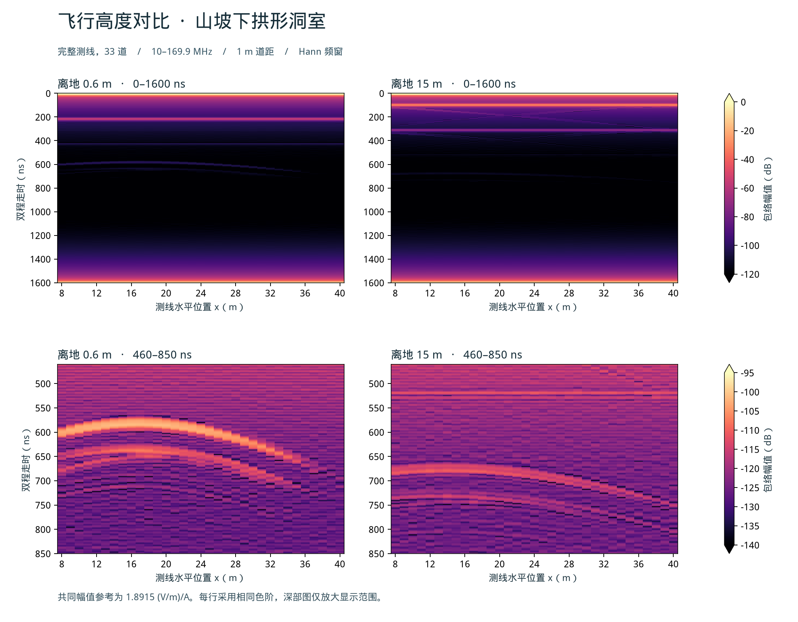

# 30m深构筑材料正演仿真

在一段 20% 坡度的山坡下建立有完整拱顶、侧墙和底板的混凝土洞室，比较收发天线沿坡飞行、距当地坡面竖直高度分别为 **0.6 m** 和 **15 m** 时的回波。两条线均已完成 33 道三维正演，包含洞室正上方的第 17 道。



## 几何与材料

x 指向上坡，y 沿洞轴，z 自模型底面向上，坐标单位为 m。坡面满足 `z = 41.6 + 0.2x`。在拱顶中心 x = 24 m 处，坡面标高为 46.4 m，拱顶外缘标高为 16.4 m，两者竖直相距 **30 m**。洞室沿 y 贯穿 20 m 计算域。内拱半径 6 m，两侧直墙高 2 m，净宽 12 m、净高 8 m；拱圈、侧墙和底板厚度均为 0.4 m。

| 中心线上从坡面向下 | 竖向深度（m） | 相对介电常数 εᵣ | 电导率 σ（S/m） |
| --- | ---: | ---: | ---: |
| 表层黏土 | 0–8.0 | 16 | 0.004 |
| 拱顶以上砂岩 | 8.0–30.0 | 6.25 | 0.001 |
| 混凝土拱顶 | 30.0–30.4 | 8 | 0.006 |
| 洞内空气 | 30.4–38.4 | 1 | 0 |
| 混凝土底板 | 38.4–38.8 | 8 | 0.006 |
| 底板以下砂岩，至计算域底面 | 38.8–46.4 | 6.25 | 0.001 |

各介质相对磁导率均为 1。几何示意图采用 0.6 m 工况的 56 m 计算域顶界。下载后可在浏览器打开三维模型，拖动旋转、剖开山体或单独查看衬砌。[三维几何示意图](figures/geometry.png) · [离线交互模型](geometry.html)

## 采集与求解

| 参数 | 设定 |
| --- | --- |
| 测线与天线 | x = 8–40 m，水平道距 1 m；Tx 与 Rx 分别位于 y = 9.4 m 和 10.6 m，收发距 1.2 m |
| 激励与观测 | y 极化赫兹偶极子，单样点冲激，记录 Ey；每道求解一次，再以源电流归一化计算各频点响应 |
| 频率与时窗 | 10–169.9 MHz，步长 0.3 MHz，共 534 点；FDTD 时窗 1600 ns |
| 重建 | gprMax 4.0.1 SFCW 工具箱，直接傅里叶求值，Hann 频窗，4 倍补零；图中时间为 ns |
| 计算域 | 低空 48 × 20 × 56 m，高空 48 × 20 × 70.4 m；增加的 14.4 m 空气层为抬高后的天线保留顶部余量 |
| 网格与计算资源 | Δx = 1/23 m，Δy = Δz = 0.04 m；SCNet A800 80 GB，CUDA 单精度，每道一张卡，各道并行 |

## 读取结果

- `data/{0.6m,15m}/results/merged.h5` 保存 33 道原始时域 Ey 和各道坐标。数据集 `/rxs/rx1/Ey` 为 20,233 个时间采样 × 33 道。
- `data/{0.6m,15m}/results/sfcw.h5` 保存 `/frequency`（Hz）、`/response`（534 频点 × 33 道复频响）、`/time_response/time`（s）和 `/time_response/complex_envelope`。两组 `raw/trace_001.h5` 保留了各自的归一化源记录。
- 两个高度在同一位置逐道配对，使用共同的包络幅值参考。全线的黏土底界时窗峰值中位数由 **215.36 ns** 移至 **308.99 ns**，幅值变化中位数为 **−16.06 dB**。在拱顶正上方第 17 道，深部时窗峰值由 **597.69 ns** 移至 **692.88 ns**，幅值变化为 **−9.96 dB**。峰值按各自时窗内的最大包络样点选取，单凭该值难以区分拱顶内外缘和底板两面的反射。

[0.6 m 完整剖面](figures/bscan_0.6m.png) · [15 m 完整剖面与深部放大](figures/bscan_15m.png) · [逐道测量 CSV](data/station_metrics.csv) · [分区汇总 CSV](data/region_metrics.csv)

## 复现

从本案例目录运行。已有 HDF5 可直接用于重画对照图和重新计算 CSV，需要 Python、NumPy、h5py 和 Matplotlib。

```bash
python analysis/compare_heights.py
```

重新正演需要安装支持 CUDA 的 gprMax 4.0.1，并激活相应 Python 环境。每一工况的模型输入和测点表都在 `models/` 中，扫频列表由两者共用。[gprMax 4.0.1 源码](https://github.com/gprMax/gprMax/tree/v.4.0.1) · [官方 SFCW 工具箱](https://github.com/gprMax/gprMax/tree/v.4.0.1/gprMax/toolboxes/SFCW)

以 15 m 工况为例，下面的命令重算第 17 道。计算整线时对道号 1–33 各执行一次；在 Slurm 数组作业中可用 `"$SLURM_ARRAY_TASK_ID"` 替换道号。33 道齐全后再合并。把 `15m` 换成 `0.6m` 即可复现低空工况。新计算结果写入 `runs/`。

```bash
python scripts/reproduce.py station 15m 17
# 该工况的 33 道均已生成后
python scripts/reproduce.py merge 15m
```
